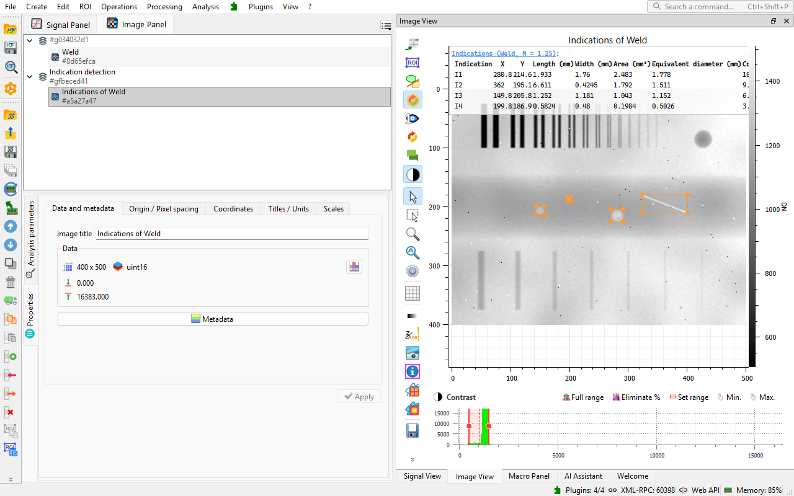
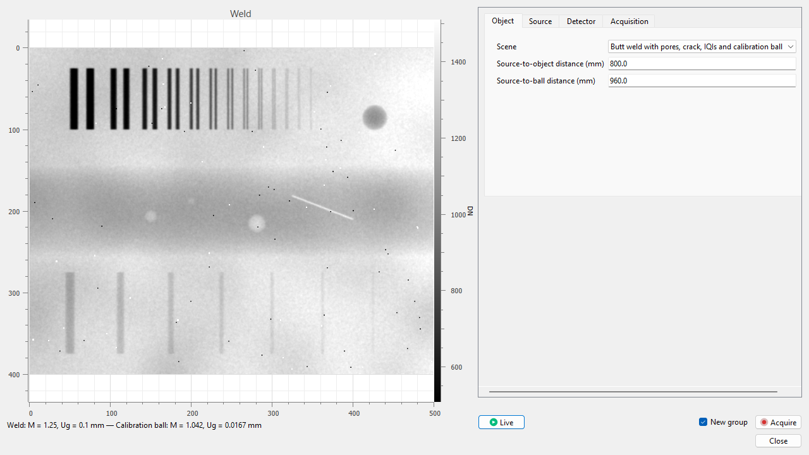

#  X-ray Radiography & NDT

A [DataLab](https://datalab-platform.com/) plugin for X-ray radiography and non-destructive testing (NDT): radiographic display, magnifications and calibrated measurements, detector corrections, physical quantities, enhancement, image quality and NDT measurements.



> **Status: Alpha.** The methods are validated on synthetic data with known truth and checked on open real data. They take inspiration from radiography standards (ISO 17636-2, ISO 19232, ASTM E2597, ISO 20769) without claiming compliance. The plugin has no medical diagnostic purpose.

## Features

| Topic | What the plugin does | Guide |
| --- | --- | --- |
| Display | Gray scale and automatic window for every new image, film convention, windows from regions of interest or DICOM attributes | [Radiographic display](doc/display.md) |
| Magnifications | Several named magnifications per image, one per object plane, from a value, the distances, a known length or a calibration ball; coordinates in any plane; geometry calculator | [Magnifications](doc/magnifications.md) |
| Measurements | Distances, angles, diameters and areas in pixels, in the detector plane and in each object plane, at once | [Measurements](doc/measurements.md) |
| Detector corrections | Offset and gain correction with dark and flat images, defective pixels | [Corrections](doc/corrections.md) |
| Physical quantities | Attenuation, equivalent thickness, step wedge thickness calibration with beam hardening | [Corrections](doc/corrections.md#physical-quantities) |
| Enhancement | Background flattening, unsharp mask, adaptive equalization, denoising, robust frame averaging, with sizes in mm | [Enhancement](doc/enhancement.md) |
| Image quality | SNR and normalized SNR, CNR, basic spatial resolution with a duplex IQI | [Image quality](doc/image-quality.md) |
| NDT measurements | Wall thickness in tangential radiography, detection and sizing of indications | [NDT measurements](doc/ndt-measurements.md) |
| DICOM | Pixel spacing, magnification, window and gray scale of DICOM and DICONDE files | [DICOM images](doc/dicom.md) |
| Simulator | Live X-ray radiography simulator with known truth, simulated and real-data examples | [Simulator and examples](doc/simulator.md) |

## Installation

Python 3.10 or later is required in a Python environment; the standalone DataLab application supplies its own interpreter.

- **DataLab Desktop:** the plugin needs DataLab 1.4 or later. Download the wheel (`.whl`) attached to the latest [release](https://github.com/DataLab-Platform/datalab-radiography/releases) and install it with **Plugins > Configure plugins... > From file**. This also works with the standalone version of DataLab. In a Python environment, you may instead install it with pip:

  ```bash
  pip install git+https://github.com/DataLab-Platform/datalab-radiography.git
  ```

- **DataLab-Web:** [DataLab-Web](https://github.com/DataLab-Platform/web) bundles the plugin (DICOM attributes are not read in the browser).

## First Run

1. In the image panel, choose **Plugins > X-ray Radiography & NDT > Examples > Simulated weld...**: a weld radiograph with pores, a crack, image quality indicators and a calibration ball, with two magnifications.
2. Choose **Measurements > Measurement tool...** and draw a segment: its length is given in pixels, in the detector plane and in both object planes.
3. Choose **NDT measurements > Indication detection...** and accept the parameters: the pores and the crack are annotated and sized in mm.

See [Getting started](doc/getting-started.md).

## Simulator

The **X-ray radiography simulator** shows a live view of a simulated radiograph (weld, pipe, step wedge, cast plate) next to its settings: geometry, focal spot, exposure and detector. It acquires radiographs, dark and flat images with their geometry, magnifications and ground truth. See [Simulator and examples](doc/simulator.md).



## Data and Licenses

The real-data examples (walnut, circuit board, knee phantom) are reduced extracts of open datasets under the CC BY 4.0 license, listed with their attribution in [SOURCES.md](src/datalab_radiography/examples/SOURCES.md).

## Documentation

- [Documentation index](doc/README.md)
- [Qualification](doc/qualification.md)
- [Contributing](CONTRIBUTING.md)
- [Changelog](CHANGELOG.md)

## License

BSD 3-Clause, see [LICENSE](LICENSE).
